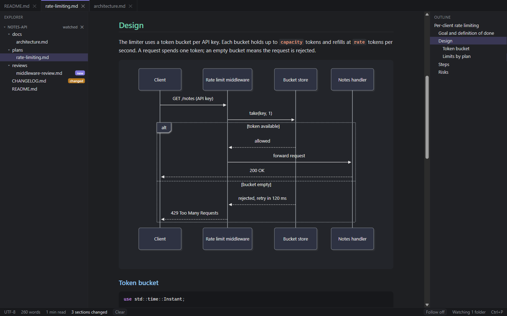
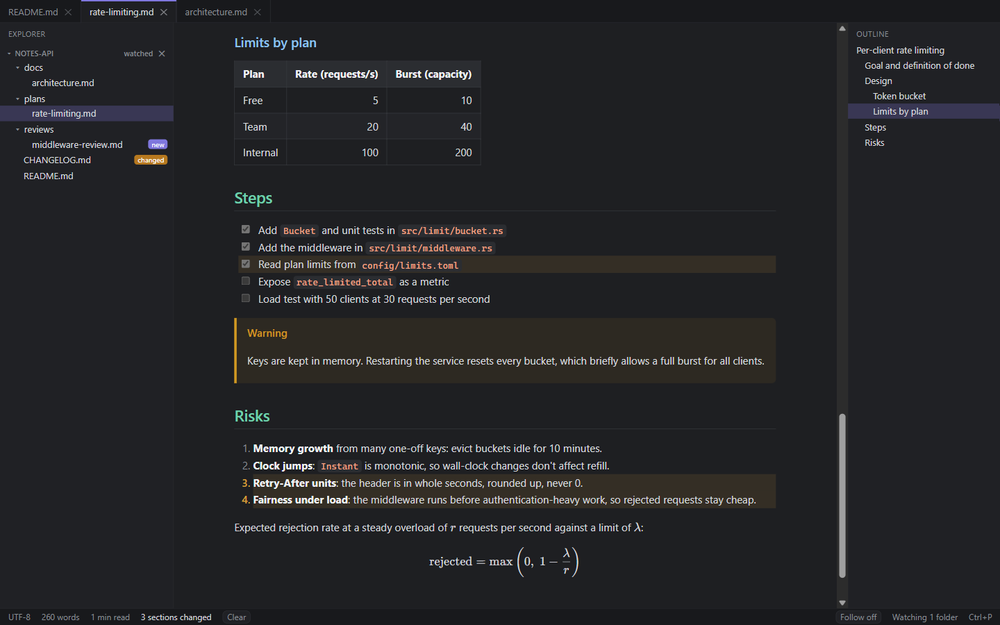
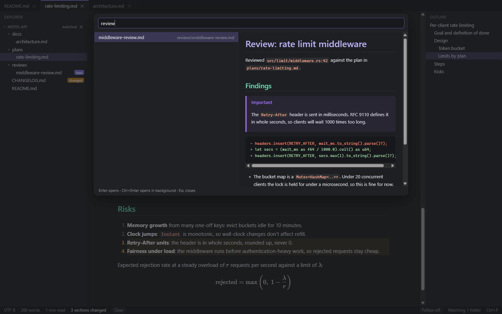
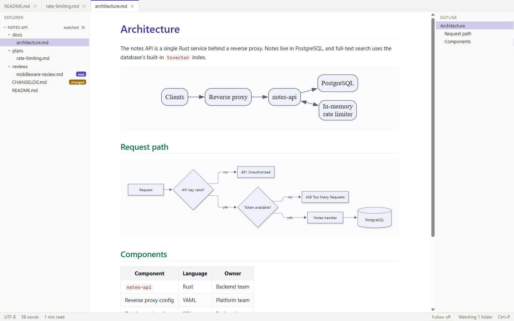
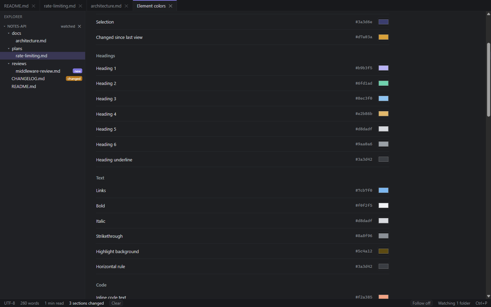

# Readout

Readout is a Markdown viewer for Windows. It opens every file as a tab in one window, watches the folders AI agents write to, and lets you pick a color for each document element. Small edits, such as ticking a task or fixing a line, happen in place.



## What it does

- Opens `.md` files in browser-style tabs. A second double-click, a multi-select in Explorer, or `readout file.md` in a terminal adds tabs to the running window. Links open in the same tab, with back and forward (Alt+Left, Alt+Right).
- An explorer and an outline that collapse to a thin strip and resize by dragging their edge, plus a status bar with the word count and reading time.
- Watches folders you choose. New and changed Markdown files get badges in the explorer, open files reload in place, changed sections are highlighted, and "View changes" shows them side by side against the version you last read. A file that changes in a background tab raises a notice.
- Follow mode keeps a growing file scrolled to the end.
- Renders GitHub Flavored Markdown: tables, task lists, footnotes, alerts such as `> [!NOTE]`, front matter, syntax-highlighted code, KaTeX math, Mermaid and Graphviz diagrams, and local or remote images. Click an image or a diagram to zoom and pan.
- Edits: click a task checkbox to tick it in the file, or press F2 for the Markdown source beside a live preview. Readout won't overwrite a file that changed on disk while you were editing, and keeps the file's line endings. Editing can be switched off in Settings.
- F4 opens the current file at the current line in your editor. The command is a template, for example `cursor --goto "{file}:{line}"`. Backticked file paths in documents open the same way.
- Quick open (Ctrl+P) with a preview: type a file name, `>` for commands, `@` for headings in this file, `#` for headings in every file. Ctrl+Shift+F searches the text of every file.
- Export a document as one self-contained HTML file, or print it and save as PDF.
- Dark theme by default, a light theme, or follow Windows. Every element color is editable in Settings, Element colors. Animations turn off when Windows "Animation effects" is off.
- Works offline. Update checks are off until you switch them on.

## Screenshots

The screenshots use a sample project, a small notes API, with planning docs of the kind a coding agent writes.

**Changed since you last looked.** The agent ticked a step and added a risk while the file was open. Readout reloaded in place and marked the three changed blocks.



**Quick open with preview.** Ctrl+P searches file names. `#` searches headings in every file, `@` searches this file, and `>` runs commands.



**Light theme and diagrams.** Graphviz and Mermaid diagrams render offline and follow the theme colors.



**A color for every element.** Each heading level, links, code, alerts, tables, diagrams and the app's own panels have their own color, kept separately for the dark and light themes.



## Keys

| Key | Action |
|---|---|
| Ctrl+O | Open file |
| Ctrl+K, then Ctrl+O | Open folder |
| Ctrl+Tab, Ctrl+Shift+Tab | Next or previous tab |
| Ctrl+1 to Ctrl+9 | Go to a tab |
| Ctrl+W | Close tab (pinned tabs stay open) |
| Ctrl+Shift+T | Reopen the last closed tab |
| Alt+Left, Alt+Right | Back, forward |
| Ctrl+P, Ctrl+Shift+P | Quick open, commands |
| Ctrl+Shift+O | Go to a heading in this file |
| Ctrl+F | Find in page |
| Ctrl+Shift+F | Search in files |
| Ctrl+B, Ctrl+Alt+B | Show or hide the explorer, the outline |
| Ctrl+=, Ctrl+-, Ctrl+0 | Larger, smaller, reset text size (also Ctrl+mouse wheel) |
| F2 | Edit the source in a split view |
| Ctrl+S | Save (in the split view) |
| F4 | Open in editor |
| F5 | Reload the file |
| Ctrl+Alt+F | Follow mode |
| Ctrl+Shift+E | Export as HTML |
| Ctrl+Alt+P | Print or save as PDF |
| Ctrl+, | Settings |

Right-click a tab to pin it, middle-click to close it, and drag to reorder.

## Install

Download the latest `Readout_<version>_x64-setup.exe` from the [Releases page](https://github.com/santhoshunt/readout/releases) and run it. The installer isn't code-signed yet, so Windows SmartScreen shows "Windows protected your PC" the first time. Choose More info, then Run anyway.

It installs for the current user without admin rights and adds:

- "Open folder in Readout" when you right-click a folder or the empty space inside one, under Show more options on Windows 11.
- "Open in Readout" when you right-click `.md` and `.markdown` files.
- The install folder on your user PATH, so `readout .` opens the current folder from a terminal.

Windows doesn't let an installer make itself the default app. The first time you double-click an `.md` file, choose Readout and select "Always".

Readout keeps its settings, session and "seen" snapshots in `%APPDATA%\com.santhoshunt.readout`.

## Updates

Settings, Updates has "Check for updates now" and an opt-in "Check for updates automatically", which asks `github.com` once a day. Readout always asks before installing. Updates are signed, and Readout refuses an installer whose signature doesn't match the key built into it.

## Code signing policy

See [docs/code-signing-policy.md](docs/code-signing-policy.md) for how releases are built and signed, and what Readout sends over the network.

## Build from source

Requirements: Node.js 20 or later, Rust 1.90 or later, and the Visual Studio C++ build tools.

```powershell
npx npm@11 install
.\npm.cmd run tauri dev      # run with hot reload
```

`npm.cmd` runs the npm version pinned in `package.json`, so a different global npm doesn't matter.

Release builds sign update artifacts, so `tauri build` needs the updater key in the environment (`TAURI_SIGNING_PRIVATE_KEY` and `TAURI_SIGNING_PRIVATE_KEY_PASSWORD`). Releases are built by [the release workflow](.github/workflows/release.yml): push a tag such as `v0.2.0` that matches `version` in `src-tauri/tauri.conf.json`, then publish the draft release it creates.

## License

MIT. See [LICENSE](LICENSE).
